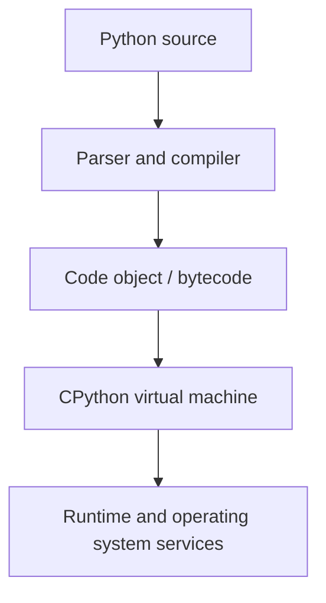

# Python Architecture

> Part of [Module 00 — Introduction to Python](../README.md).

Python is a language with multiple implementations. CPython is the most widely used implementation and the default distribution from python.org.

## Simplified CPython model

The diagram is deliberately simplified. The language specification, CPython implementation details and operating-system services are different layers.

## Important distinctions

- Python: the language.
- CPython: an implementation of the language.
- Bytecode: an intermediate instruction representation used by CPython.
- Virtual machine: the execution machinery that interprets CPython bytecode.

Further reading: [CPython internals documentation](https://devguide.python.org/internals/)
