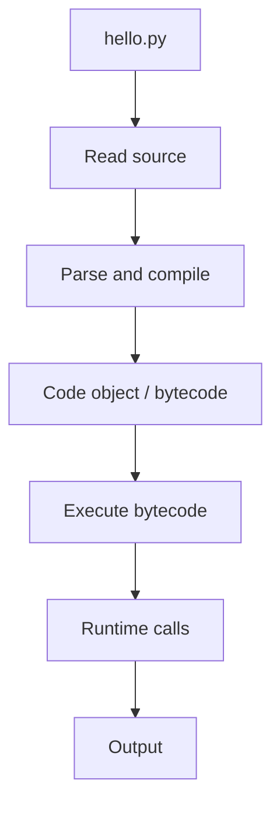

# Python Execution Workflow

> Part of [Module 00 — Introduction to Python](../README.md).

A useful beginner mental model for CPython is: source code is parsed, compiled to code objects containing bytecode, then executed by the CPython virtual machine.



This is not a complete description of imports, caching, optimization, native extensions or every implementation.

## Try it

Create `hello.py`:

```python
message = "Python execution started"
print(message)
```

Run `python hello.py` or `python3 hello.py`, depending on your system.

## Questions

1. What is source code?
2. What is bytecode in CPython?
3. Does every Python implementation have identical internals?
