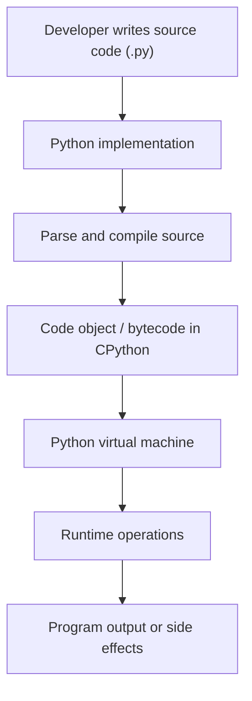
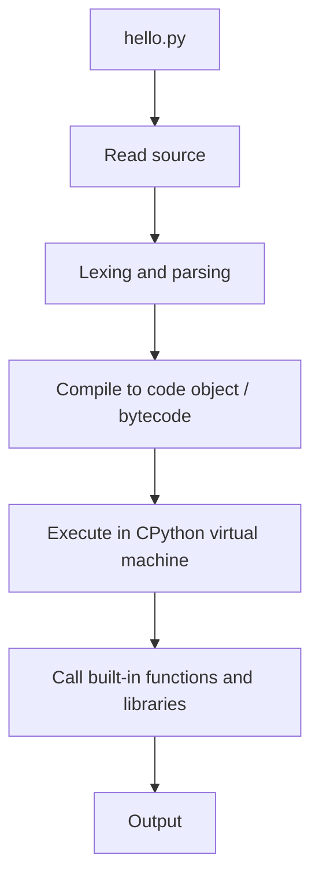

# 00 — Introduction to Python

> **Level:** Beginner  
> **Prerequisites:** None  
> **Goal:** Understand what Python is, where it is used, how a Python program runs, and how the Python ecosystem is organized.

---

## Learning objectives

By the end of this module, you should be able to:

- Explain Python in your own words.
- Describe the origin and evolution of Python at a high level.
- Identify important Python language characteristics.
- Recognize common areas where Python is used.
- Compare Python with compiled and other high-level languages.
- Explain the major stages involved in executing a Python program.
- Distinguish the Python language from implementations such as CPython and PyPy.
- Explain the roles of the standard library, third-party packages and PyPI.
- Identify practical Python use cases in DevOps and DevSecOps.

## Module contents

| No. | Topic | Description |
|---:|---|---|
| 01 | [What is Python?](01-What-is-Python/README.md) | Definition, programming languages and Python's purpose |
| 02 | [History and evolution](02-History-and-Evolution/README.md) | Origins, creator and major milestones |
| 03 | [Features and design philosophy](03-Features-and-Design-Philosophy/README.md) | Readability, dynamic typing, object model and philosophy |
| 04 | [Python applications](04-Python-Applications/README.md) | Web, automation, data, AI, testing and more |
| 05 | [Python vs other languages](05-Python-vs-Other-Languages/README.md) | Comparison with C, C++, Java and JavaScript |
| 06 | [Python architecture](06-Python-Architecture/README.md) | Language implementation, interpreter and runtime concepts |
| 07 | [Python execution workflow](07-Python-Execution-Workflow/README.md) | From source code to program execution |
| 08 | [Python implementations](08-Python-Implementations/README.md) | CPython, PyPy, Jython and other implementations |
| 09 | [Python ecosystem](09-Python-Ecosystem/README.md) | Standard library, packages, pip and PyPI |
| 10 | [Python for DevOps](10-Python-for-DevOps/README.md) | Infrastructure and delivery automation use cases |
| 11 | [Advantages and limitations](11-Advantages-and-Limitations/README.md) | Strengths, trade-offs and selection criteria |
| 12 | [Exercises and assessment](12-Exercises-and-Assessment/README.md) | Knowledge checks and review questions |

## 1. What is Python?

Python is a high-level, general-purpose programming language known for readable syntax and a broad ecosystem of libraries. It is used to write scripts, automate tasks, build applications, process data, develop APIs and work with infrastructure.

A programming language provides rules and constructs that let a developer express instructions and data transformations in a form that a language implementation can execute.

Python is not limited to one type of application. It can be used for small command-line scripts as well as large software systems.

### A first Python example

```python
print("Hello, Python Junction!")
```

Run the file:

```bash
python hello.py
```

On systems where the Python command is `python3`:

```bash
python3 hello.py
```

Expected output:

```text
Hello, Python Junction!
```

`print()` is a built-in function that writes a representation of its argument to standard output.

## 2. History and evolution

Python was created by Guido van Rossum and first released publicly in 1991. Its development emphasized readable code and a practical language that could support a wide range of programming tasks.

Python 2 and Python 3 were two major generations. Python 2 reached end of life in 2020. New learning and development should use a currently supported Python 3 release.

For accurate version status and release details, consult the official Python release pages rather than relying on a fixed version number in this repository.

## 3. Important characteristics

- **High-level:** Many low-level details are handled by the language implementation and runtime.
- **General-purpose:** Suitable for many categories of software.
- **Readable syntax:** Code is designed to be relatively easy to read and maintain.
- **Dynamically typed:** Variable names are not normally declared with fixed types; objects have types at runtime.
- **Strongly typed:** Operations that are not valid for the involved types generally require explicit conversion or produce an error.
- **Multi-paradigm:** Supports procedural, object-oriented and functional programming styles.
- **Large ecosystem:** Includes a substantial standard library and many third-party packages.
- **Cross-platform:** Python programs can run on multiple operating systems, subject to dependencies and platform-specific behaviour.

These characteristics describe common Python usage; they do not mean every Python program is automatically portable, fast or secure.

## 4. Where Python is used

| Area | Example use |
|---|---|
| Automation | Repetitive file, system and operational tasks |
| Web development | APIs and web backends |
| Data engineering | Data extraction, transformation and loading |
| Data science | Data analysis and visualization |
| Artificial intelligence | Machine learning and model workflows |
| Testing | Unit, integration and end-to-end test automation |
| DevOps | CI/CD helpers, deployment tooling and infrastructure APIs |
| Security engineering | Log analysis, validation and security-tool integrations |
| Networking | API clients, network utilities and configuration automation |

## 5. Python compared with other languages

There is no universally best programming language. Selection depends on requirements such as performance, ecosystem, runtime, deployment environment, team skills and maintainability.

| Language | Common strengths | Typical use cases |
|---|---|---|
| Python | Readability, productivity and broad libraries | Automation, APIs, data and scripting |
| C | Low-level control and performance | Operating systems, embedded software |
| C++ | Performance and systems-level capabilities | Game engines, systems and performance-sensitive software |
| Java | Mature runtime and enterprise ecosystem | Enterprise services and large applications |
| JavaScript | Native browser ecosystem and server-side runtime | Web frontends and full-stack applications |

Avoid reducing a language comparison to claims such as "Python is always slower" or "Java is always faster." Performance depends on the workload, implementation, libraries and architecture.

## 6. Python architecture and execution

Python is a language; CPython is its most widely used implementation. In CPython, source code is parsed and compiled to Python bytecode, which is executed by the CPython virtual machine. Implementation details can differ across Python implementations and versions.



Important distinctions:

- Python source code is the code written by the developer.
- Bytecode is an intermediate instruction representation used by CPython.
- The Python virtual machine executes bytecode in CPython.
- The operating system and native libraries provide services used by the running process.

Do not assume every Python implementation uses the same bytecode format or execution model.

## 7. Python execution workflow

A simplified CPython workflow:



This is a teaching model, not a complete specification of every internal runtime operation. Import handling, optimization, caching and native extensions introduce additional details.

## 8. Python implementations

- **CPython:** The reference implementation, written primarily in C; the default implementation distributed by python.org.
- **PyPy:** An alternative implementation with a just-in-time compiler for supported workloads.
- **Jython:** Python implementation designed to run on the Java platform; compatibility depends on its supported Python language version.
- **IronPython:** Python implementation for the .NET ecosystem; check its current compatibility and release status before choosing it.

Choose an implementation based on compatibility, supported language version, deployment environment and workload. Most beginners should start with CPython.

## 9. Python ecosystem

The Python ecosystem includes:

1. **Language:** Syntax, semantics and built-in types.
2. **Implementation/runtime:** Executes Python programs.
3. **Standard library:** Modules distributed with Python.
4. **Third-party packages:** Reusable libraries maintained outside the standard library.
5. **pip:** A commonly used package installer.
6. **PyPI:** The Python Package Index, a repository of Python packages.
7. **Virtual environments:** Isolated project environments for dependencies.
8. **Packaging tools:** Tools and standards used to build and distribute Python projects.

Official references:
- [Python documentation](https://docs.python.org/3/)
- [Python tutorial](https://docs.python.org/3/tutorial/)
- [Python Package Index](https://pypi.org/)
- [Python Packaging User Guide](https://packaging.python.org/)

## 10. Python for DevOps and DevSecOps

Python can support engineering workflows such as:

- Parsing application and infrastructure logs.
- Calling REST APIs for deployment and reporting workflows.
- Validating configuration files and deployment inputs.
- Automating backups and housekeeping tasks.
- Generating deployment and vulnerability reports.
- Integrating with cloud, container and orchestration APIs.
- Supporting CI/CD pipelines with repeatable helper scripts.

Examples later in this repository will cover these use cases. Scripts that change infrastructure must include safe defaults, clear logging, error handling, least-privilege credentials and testing.

## 11. Advantages and limitations

### Advantages

- Readable syntax and a gentle learning curve.
- Broad standard library and third-party ecosystem.
- Useful for scripting, automation and application development.
- Strong community and extensive learning resources.
- Integrates with native libraries and external systems.

### Limitations and trade-offs

- Pure Python can be slower than compiled languages for some CPU-bound workloads.
- Dynamic typing can allow some errors to appear at runtime; tests and type checking can help.
- Dependency management and environment consistency require discipline.
- The global interpreter lock in conventional CPython builds affects CPU-bound threading; details vary by Python version and build, including free-threaded builds.
- Not every library, runtime or deployment target supports every operating system or Python version.

## 12. Knowledge check

Try answering these before moving to the next module:

1. What is Python, and why is it called general-purpose?
2. Who created Python, and when was it first released?
3. What is the difference between the Python language and CPython?
4. What is Python bytecode in the context of CPython?
5. What role does the Python virtual machine play?
6. What is the difference between the standard library and a third-party package?
7. What is PyPI?
8. Give three examples of Python use in DevOps.
9. Why should a project use a virtual environment?
10. Name two trade-offs to consider when choosing Python.

## Completion checklist

- [ ] I can explain Python without reading the definition.
- [ ] I can identify common Python use cases.
- [ ] I can describe the simplified CPython execution workflow.
- [ ] I can distinguish Python, CPython and bytecode.
- [ ] I understand the role of pip and PyPI.
- [ ] I can describe at least three DevOps automation use cases.
- [ ] I have completed the knowledge-check questions.

## Further reading

- [About Python](https://www.python.org/about/)
- [Python documentation](https://docs.python.org/3/)
- [Python FAQ](https://docs.python.org/3/faq/general.html)
- [Python release status](https://devguide.python.org/versions/)
