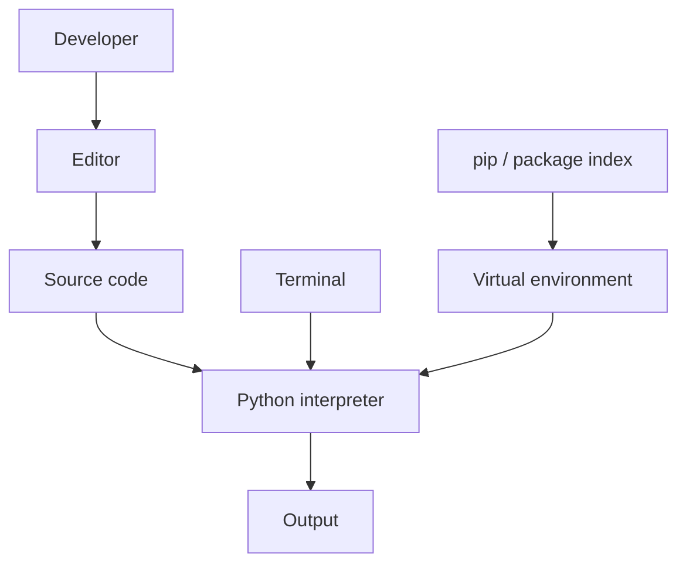

# Understanding Python Environments

> Part of [Module 01 — Python Environment Setup](../README.md).

A development environment is the set of tools and configuration used to create, run, test and maintain software.

## Main components

| Component | Responsibility |
|---|---|
| Python implementation | Runs Python code |
| Editor / IDE | Creates and edits source files |
| Terminal | Runs commands and scripts |
| pip | Installs Python packages |
| Virtual environment | Isolates project dependencies |
| Libraries | Provide reusable functionality |

## Important distinction

VS Code is an editor. The Microsoft Python extension adds Python-aware features, but a Python interpreter must also be installed and selected.

## Exercise

Identify which interpreter your terminal currently uses with `python3 --version` and `command -v python3` on Linux, or `python --version` and `where.exe python` on Windows.
