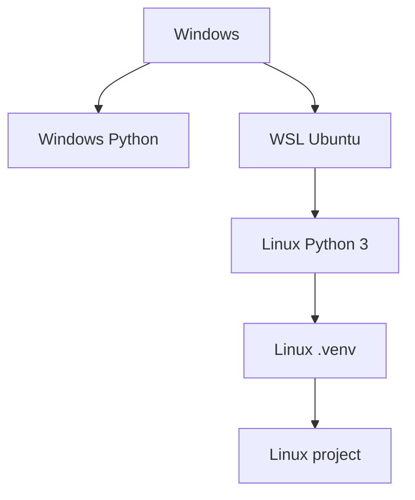

# Python on WSL

> Part of [Module 01 — Python Environment Setup](../README.md).

WSL provides a Linux environment on Windows. Python installed inside Ubuntu/WSL is separate from a Windows Python installation.



## Verify WSL Python

```bash
python3 --version
command -v python3
```

Install required components if missing:

```bash
sudo apt update
sudo apt install -y python3 python3-pip python3-venv
```

## Recommended project location

```bash
mkdir -p ~/projects/python-practice
cd ~/projects/python-practice
```

For Linux-based development, keep project files in the WSL filesystem and use the VS Code WSL extension. Open the project with:

```bash
code .
```

Do not reuse a Windows virtual environment from WSL or a Linux virtual environment from Windows.
