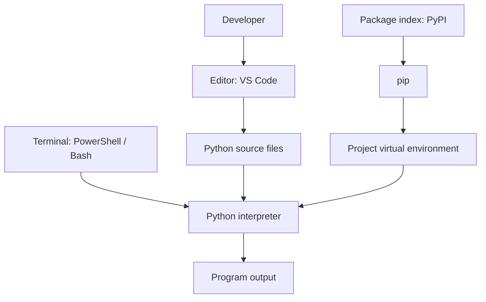
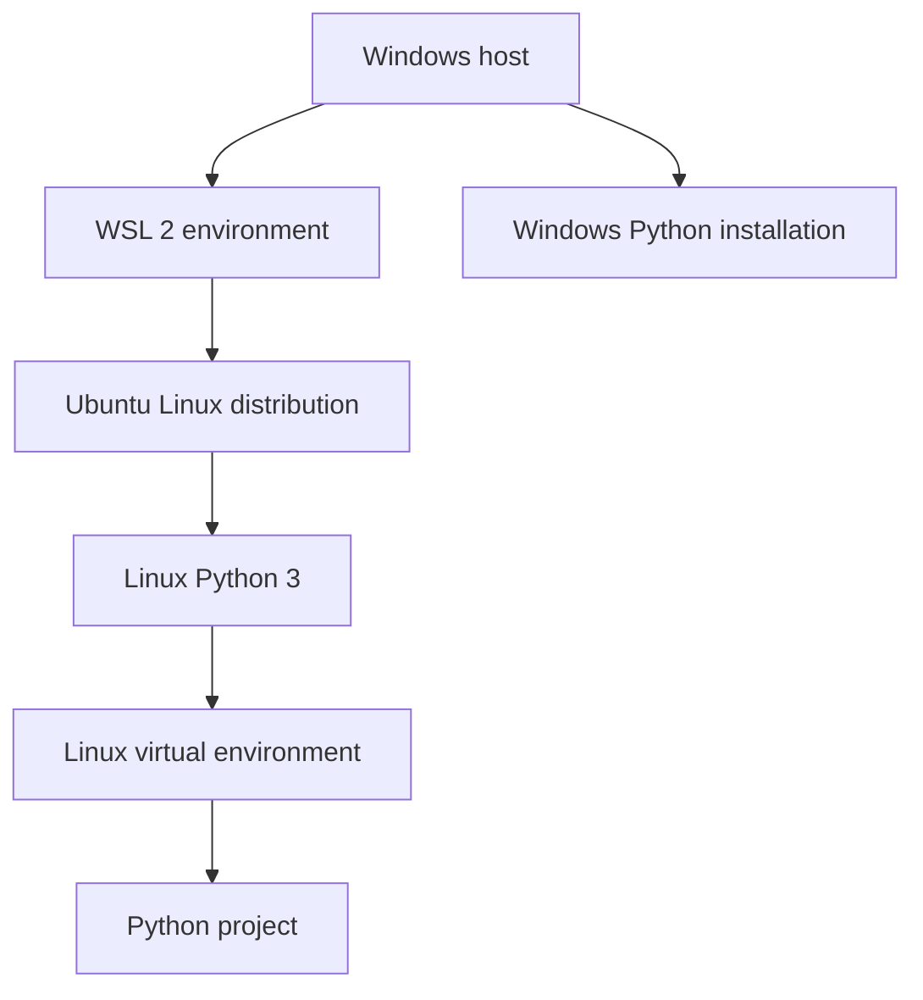
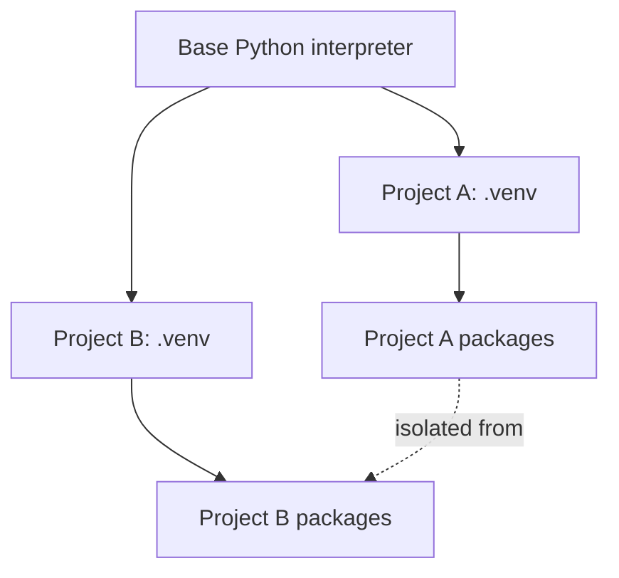

# 01 — Python Environment Setup

> **Level:** Beginner  
> **Prerequisites:** Module 00 — Introduction to Python  
> **Platforms:** Windows, Ubuntu Linux and Windows Subsystem for Linux (WSL)  
> **Goal:** Prepare a reliable Python development environment and learn how to run programs and manage project dependencies safely.

---

## Learning objectives

By the end of this module, you should be able to:

- Explain the parts of a Python development environment.
- Install or verify Python on Windows and Ubuntu.
- Understand how Python works inside WSL.
- Check which Python executable your terminal is using.
- Use the Python interactive interpreter and run `.py` files.
- Configure Visual Studio Code for Python development.
- Understand `pip`, packages, package indexes and dependency versions.
- Create, activate, deactivate and remove a virtual environment.
- Diagnose common installation, PATH and package-installation problems.

## Module contents

| No. | Topic | Main outcome |
|---:|---|---|
| 01 | [Understanding Python environments](01-Understanding-Python-Environments/README.md) | Understand interpreter, editor, terminal and dependencies |
| 02 | [Installing Python on Windows](02-Installing-Python-on-Windows/README.md) | Install and verify Python on Windows |
| 03 | [Installing Python on Ubuntu](03-Installing-Python-on-Ubuntu/README.md) | Use Ubuntu packages and verify Python 3 |
| 04 | [Python on WSL](04-Python-on-WSL/README.md) | Work with Linux Python from Windows |
| 05 | [Understanding PATH](05-Understanding-PATH/README.md) | Understand command lookup and interpreter selection |
| 06 | [Python interpreter and shell](06-Python-Interpreter-and-Shell/README.md) | Use interactive mode and inspect the interpreter |
| 07 | [Installing VS Code](07-Installing-VS-Code/README.md) | Install and open the editor |
| 08 | [VS Code Python extension](08-VS-Code-Python-Extension/README.md) | Select interpreters and run/debug Python |
| 09 | [Running Python scripts](09-Running-Python-Scripts/README.md) | Execute scripts from terminals and editor |
| 10 | [pip and package installation](10-pip-and-Package-Installation/README.md) | Install and inspect packages |
| 11 | [Virtual environments](11-Virtual-Environments/README.md) | Isolate project dependencies |
| 12 | [Troubleshooting](12-Troubleshooting/README.md) | Diagnose common environment problems |

## 1. What is a Python development environment?

A Python development environment is the collection of software and configuration used to write, run, test and maintain Python programs.

It commonly includes:

- **Python implementation/interpreter:** Runs Python programs.
- **Editor or IDE:** Used to create and edit source files.
- **Terminal:** Used to run commands and programs.
- **pip:** Installs Python packages.
- **Virtual environment:** Isolates project-specific packages.
- **Libraries and dependencies:** Reusable code required by a project.
- **Version control:** Tracks changes to source code.



An editor does not replace Python. Installing the VS Code Python extension also does not automatically install a Python interpreter.

## 2. Before installing: inspect your machine

Do not install another Python version before checking what is already present.

### Windows PowerShell

```powershell
python --version
py --version
where.exe python
where.exe py
```

Some commands may not exist, depending on the installation method. That is useful diagnostic information, not necessarily a failure.

### Ubuntu / WSL

```bash
python3 --version
command -v python3
which -a python3
```

Check pip availability:

```bash
python3 -m pip --version
```

If pip is not installed, follow the Ubuntu section. Do not assume every Linux distribution includes pip by default.

## 3. Install Python on Windows

The official Python documentation currently recommends the Python Install Manager for Windows. It can be installed from the Microsoft Store or from python.org. Follow the current official installation instructions because installer workflows can change.

Official guide: [Using Python on Windows](https://docs.python.org/3/using/windows.html)

One WinGet route for the Python Install Manager is:

```powershell
winget install 9NQ7512CXL7T -e
```

After installation, open a new PowerShell window. Use the manager to see available runtimes:

```powershell
py list
```

Install a supported Python 3 runtime using the manager's documented command. For example, where Python 3.14 is available:

```powershell
py install 3.14
```

Verify:

```powershell
python --version
py --version
python -m pip --version
```

If your organization manages software centrally, follow its approved installation process instead of bypassing device controls.

### Alternative installation route

The Python downloads page also provides installers and current guidance:

[https://www.python.org/downloads/windows/](https://www.python.org/downloads/windows/)

During installation, follow the installer's PATH and launcher guidance. Do not manually add random directories to PATH without knowing which executable they contain.

## 4. Install Python on Ubuntu

First inspect the existing installation:

```bash
python3 --version
```

If Python 3 is not installed, or required development components are missing, use the distribution package manager:

```bash
sudo apt update
sudo apt install -y python3 python3-pip python3-venv
```

Verify:

```bash
python3 --version
python3 -m pip --version
python3 -m venv --help
```

Ubuntu may manage its system Python packages through `apt`. Do not replace or overwrite the distribution's system Python with a manually installed interpreter. Use virtual environments for project packages.

Official references:
- [Python documentation](https://docs.python.org/3/)
- [Ubuntu documentation](https://documentation.ubuntu.com/)

## 5. Python on WSL

WSL lets you run a Linux environment alongside Windows. A Python interpreter installed inside Ubuntu/WSL is separate from a Windows Python installation.



For Linux-based development in WSL:

1. Open the Ubuntu terminal.
2. Check `python3 --version`.
3. Install `python3-venv` and `python3-pip` if needed.
4. Keep Linux project files in the WSL Linux filesystem, for example `~/projects/`, for a Linux toolchain workflow.
5. Open the project with VS Code's WSL integration using `code .`.

Example:

```bash
mkdir -p ~/projects/python-practice
cd ~/projects/python-practice
python3 --version
```

Avoid mixing Windows and Linux interpreters or virtual environments. A Windows `.venv` is not a Linux `.venv`, and vice versa.

## 6. Understanding PATH

`PATH` is an environment variable containing directories that a shell searches when you type a command without specifying its full path.

### Linux

```bash
echo "$PATH"
command -v python3
which -a python3
```

### Windows PowerShell

```powershell
$env:Path -split ';'
Get-Command python -All
Get-Command py -All
```

If multiple Python installations exist, command lookup order can determine which one runs. Prefer checking the resolved executable rather than guessing.

In Python:

```python
import sys

print(sys.executable)
print(sys.version)
```

`sys.executable` shows the interpreter executable associated with the running Python process.

## 7. Python interactive interpreter

The interactive interpreter (often called the REPL: Read–Eval–Print Loop) lets you enter Python statements and see results immediately.

Start it:

```bash
python3
```

Example session:

```pycon
>>> 2 + 3
5
>>> print("Learning Python")
Learning Python
>>> exit()
```

On Windows, use `python` or `py` depending on the installation.

The interactive shell is useful for quick experiments. Save reusable programs in `.py` files so they can be version-controlled and executed again.

## 8. Install Visual Studio Code

Download VS Code from:

[https://code.visualstudio.com/](https://code.visualstudio.com/)

On Windows, the official setup guide provides installer options. On Ubuntu, use the official Linux installation instructions or your organization's software-management process.

For WSL development, install the Windows VS Code application and the WSL extension, then open the WSL project from the Ubuntu terminal:

```bash
code .
```

If `code` is not available inside WSL, check the VS Code WSL setup documentation and ensure the WSL extension is installed.

Official guide: [Developing in WSL with VS Code](https://code.visualstudio.com/docs/remote/wsl)

## 9. Install the Python extension in VS Code

In VS Code:

1. Open Extensions.
2. Search for **Python**.
3. Install the Microsoft Python extension.
4. Open a folder containing a `.py` file.
5. Open the Command Palette.
6. Run **Python: Select Interpreter**.
7. Select the interpreter or project virtual environment you intend to use.

The extension provides Python language support and integrates with interpreter selection, debugging and other tooling. The extension is not the interpreter itself.

Official guide: [Python in VS Code](https://code.visualstudio.com/docs/languages/python)

## 10. Run a Python script

Create a file named `hello.py`:

```python
print("Hello from Python Junction!")
```

Run from Ubuntu/WSL:

```bash
python3 hello.py
```

Run from Windows PowerShell:

```powershell
python hello.py
```

Expected output:

```text
Hello from Python Junction!
```

The command must be run from the directory containing the file, or you must provide the correct path to the file.

## 11. pip and package installation

`pip` is a package installer. It installs packages into the Python environment selected by the command.

Prefer invoking pip through the interpreter:

```bash
python3 -m pip --version
```

Inside a virtual environment:

```bash
python -m pip install requests
python -m pip show requests
python -m pip list
```

On Ubuntu, a system-managed Python installation may be marked as externally managed. If pip refuses a global installation, do not force it with `--break-system-packages` for normal project work. Create and use a virtual environment instead.

A package name on PyPI is not a guarantee that it is trustworthy. Check the package maintainer, project history, documentation, dependencies and security posture before installing packages, especially in production environments.

References:
- [pip documentation](https://pip.pypa.io/en/stable/)
- [Python Package Index](https://pypi.org/)

## 12. Virtual environments

A virtual environment is an isolated Python environment for a project. It helps keep dependencies for different projects separate.



Create a project and environment on Ubuntu/WSL:

```bash
mkdir -p ~/projects/python-environment-demo
cd ~/projects/python-environment-demo

python3 -m venv .venv
```

Activate:

```bash
source .venv/bin/activate
```

The shell prompt often displays `(.venv)`. Verify the selected interpreter:

```bash
which python
python --version
python -m pip --version
```

Install a package inside the environment:

```bash
python -m pip install requests
python -m pip show requests
```

Deactivate:

```bash
deactivate
```

Remove the environment when it is no longer needed (only after deactivating it):

```bash
rm -rf .venv
```

### Windows PowerShell virtual environment

```powershell
mkdir python-environment-demo
cd python-environment-demo

python -m venv .venv
.\.venv\Scripts\Activate.ps1
```

Verify:

```powershell
python --version
python -m pip --version
```

Deactivate:

```powershell
deactivate
```

If PowerShell blocks activation because of its execution policy, do not change the machine-wide policy blindly. You can use Command Prompt activation (`.venv\Scripts\activate.bat`) or follow Microsoft's guidance for an appropriate user-scoped policy in your environment.

### Dependency file

For a small learning project, you can record installed packages:

```bash
python -m pip freeze > requirements.txt
```

Install from the file in another environment:

```bash
python -m pip install -r requirements.txt
```

`pip freeze` records the environment's installed package versions. For larger projects, dependency declaration and locking strategy should be chosen deliberately; `requirements.txt` is not the only packaging approach.

## 13. Recommended project layout

```text
python-environment-demo/
├── .venv/                 # Local environment; do not commit
├── src/
│   └── main.py
├── tests/
├── requirements.txt
├── .gitignore
└── README.md
```

A `.gitignore` should exclude local environments and Python cache files:

```gitignore
.venv/
venv/
__pycache__/
*.py[cod]
.env
```

Never commit credentials, tokens or private configuration.

## Practical lab

Complete this lab in your Ubuntu/WSL environment:

1. Check the installed Python version.
2. Find the Python executable path.
3. Create `~/projects/python-environment-demo`.
4. Create a `.venv` virtual environment.
5. Activate it.
6. Confirm that `which python` points inside `.venv`.
7. Install `requests` inside the environment.
8. Run `python -m pip show requests`.
9. Create `hello.py` and execute it.
10. Deactivate the environment.
11. Confirm that the prompt no longer shows `(.venv)`.

## Troubleshooting quick reference

| Symptom | Diagnostic | Typical next step |
|---|---|---|
| `python: command not found` | `command -v python3` | Try `python3`; install Python if absent |
| `python` opens Microsoft Store | `Get-Command python -All` | Check Windows app execution aliases and installation |
| Wrong interpreter runs | `sys.executable` / `where.exe python` | Select the intended interpreter and inspect PATH |
| `No module named venv` | Check Ubuntu package | Install `python3-venv` using apt |
| `pip` permission error | `python -m pip --version` | Use a project virtual environment |
| `externally-managed-environment` | Check active interpreter | Create a venv; do not override system package protection |
| VS Code uses wrong Python | Python: Select Interpreter | Select the project's `.venv` interpreter |
| Cannot activate PowerShell venv | Review activation error | Use Command Prompt activation or approved user policy |
| `code` not found in WSL | `command -v code` | Check VS Code WSL extension and setup |

## Knowledge check

1. What are the main components of a Python development environment?
2. Does installing the VS Code Python extension install Python itself?
3. What is the difference between Windows Python and WSL Python?
4. What does the `PATH` environment variable do?
5. How can you identify the interpreter currently running your script?
6. What is the Python REPL?
7. What does `python -m pip` mean?
8. Why should project dependencies be installed in a virtual environment?
9. What does `requirements.txt` commonly contain?
10. Why should you avoid forcing package installation into Ubuntu's system Python?

## Completion checklist

- [ ] I checked whether Python was already installed.
- [ ] I can identify the Python executable used by my terminal.
- [ ] I understand Windows Python and WSL Python are separate.
- [ ] I can run a Python script from a terminal.
- [ ] I can use the Python interactive interpreter.
- [ ] I installed/configured VS Code and its Python extension.
- [ ] I understand pip and package installation.
- [ ] I created, activated and deactivated a virtual environment.
- [ ] I completed the practical lab.
- [ ] I answered the knowledge-check questions.

## Official references

- [Python downloads](https://www.python.org/downloads/)
- [Using Python on Windows](https://docs.python.org/3/using/windows.html)
- [Python venv documentation](https://docs.python.org/3/library/venv.html)
- [Python pip documentation](https://pip.pypa.io/en/stable/)
- [VS Code Python tutorial](https://code.visualstudio.com/docs/python/python-tutorial)
- [VS Code WSL documentation](https://code.visualstudio.com/docs/remote/wsl)
- [Python Packaging User Guide](https://packaging.python.org/)
