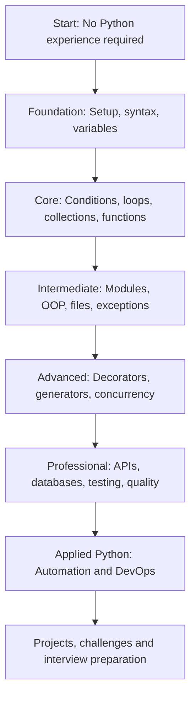

# Python Junction

<p align="center">
  <strong>A complete, practical Python learning path — from absolute beginner to advanced and DevOps automation.</strong>
</p>

<p align="center">
  
  
  
  
</p>

---

## Welcome

**Python Junction** is a structured, hands-on learning repository for anyone who wants to learn Python from the ground up and progress toward writing maintainable, production-quality programs.

The repository combines:

- Clear explanations of Python concepts.
- Small, runnable `.py` examples with expected output.
- Topic-wise exercises and solutions.
- Mermaid diagrams for workflows and architecture.
- Practical projects that reinforce the concepts.
- Testing, debugging, code quality and security practices.
- Python applications in DevOps and infrastructure automation.

You do not need prior Python experience. Follow the modules in order, practise consistently and build the projects yourself.

## Who is this repository for?

- Beginners starting programming with Python.
- Developers strengthening their Python fundamentals.
- System administrators and DevOps engineers automating repetitive work.
- Engineers preparing for Python interviews.
- Contributors who want to improve their Python knowledge through practical examples.

## Learning path



## Repository map

| Section | Learning area |
|---|---|
| `00`–`02` | Introduction, environment setup and fundamentals |
| `03`–`08` | Data types, operators, control flow and collections |
| `09`–`13` | Functions, packages, OOP, exceptions and files |
| `14`–`17` | Advanced Python, concurrency, APIs, testing and quality |
| `18` | Python for DevOps and automation |
| `19`–`23` | Projects, coding challenges, interviews, cheat sheets and resources |

Open the [complete learning roadmap](ROADMAP.md) for the recommended sequence and progress checklist.

## Getting started

### 1. Install Python

Download Python from the [official Python website](https://www.python.org/downloads/). On Windows, enable the option to add Python to PATH during installation when offered.

Verify your installation:

```bash
python --version
```

On some Linux distributions and systems, use:

```bash
python3 --version
```

Check that pip is available:

```bash
python -m pip --version
```

### 2. Clone this repository

```bash
git clone https://github.com/<your-github-username>/Python_Junction.git
cd Python_Junction
```

Replace `<your-github-username>` with your GitHub username.

### 3. Run your first Python program

Create `hello.py`:

```python
print("Hello, Python Junction!")
```

Run it:

```bash
python hello.py
```

Expected output:

```text
Hello, Python Junction!
```

### 4. Follow the modules

Start with `00-Introduction-to-Python/README.md` and continue in numerical order. Read the explanation, run the examples, modify the code and complete the exercises before moving forward.

## Documentation standard

Each topic should aim to include:

1. **Definition** — what the concept means.
2. **Why it matters** — where and why it is used.
3. **How it works** — a clear conceptual explanation.
4. **Syntax** — the relevant Python syntax.
5. **Examples** — small, runnable programs.
6. **Expected output** — what the example should produce.
7. **Diagram** — when a visual explanation adds value.
8. **Real-world use case** — how the concept is applied.
9. **Common mistakes** — pitfalls and how to avoid them.
10. **Exercises** — questions to practise independently.
11. **Review questions** — conceptual and interview-style checks.
12. **References** — official or trusted sources.

See [`templates/TOPIC_TEMPLATE.md`](templates/TOPIC_TEMPLATE.md) for the reusable format.

## Suggested development environment

- Python 3 (a currently supported release).
- VS Code or another Python-capable editor.
- A terminal: PowerShell, Windows Terminal, Linux shell or macOS Terminal.
- Git and a GitHub account.

Editor setup is covered in `01-Environment-Setup/`.

## Progress tracking

Track your progress in [ROADMAP.md](ROADMAP.md). A module is considered complete only after its explanations, examples, exercises and review checks have been completed.

## Projects

The `19-Projects/` section will contain practical projects from beginner to advanced. The DevOps-focused projects will include examples such as log analysis, backup automation, API integrations, container inspection and CI/CD support scripts.

## Contributing

Suggestions, corrections, examples and improvements are welcome. Read [CONTRIBUTING.md](CONTRIBUTING.md) before submitting changes.

## Learning resources

- [Official Python tutorial](https://docs.python.org/3/tutorial/)
- [Python Language Reference](https://docs.python.org/3/reference/)
- [Python Standard Library](https://docs.python.org/3/library/)
- [Python Packaging User Guide](https://packaging.python.org/)
- [Python Enhancement Proposals (PEPs)](https://peps.python.org/)

Prefer official documentation for language behaviour and library details. External resources should supplement, not replace, the explanations in this repository.

## License

This repository is intended to be shared as an educational resource. See [LICENSE](LICENSE) for the licensing terms.

---

**Learn. Practise. Build. Automate.**
