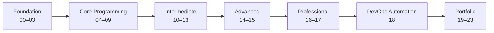

# Python Junction — Learning Roadmap

This roadmap takes a learner from no Python experience to advanced programming and practical automation. Follow the sequence, practise each topic and build projects as you progress.

## How to use this roadmap

- Work through the modules in numerical order.
- Run every example locally; do not only read the code.
- Change examples and predict the output before executing them.
- Complete exercises without immediately looking at solutions.
- Keep notes about errors, debugging steps and concepts that need revision.
- Build at least one small project after each major phase.

## Learning progression

## Phase 1 — Foundation

**Modules:** 00–03

- [ ] 00 — Introduction to Python
- [ ] 01 — Environment Setup
- [ ] 02 — Python Fundamentals
- [ ] 03 — Variables and Data Types

**Outcome:** Install Python, run scripts, understand basic syntax and work confidently with fundamental data types.

**Checkpoint project:** Personal profile and unit-conversion program.

## Phase 2 — Core programming

**Modules:** 04–09

- [ ] 04 — Operators
- [ ] 05 — Conditional Statements
- [ ] 06 — Loops and Iterations
- [ ] 07 — Python Data Structures
- [ ] 08 — Strings and Collections
- [ ] 09 — Functions

**Outcome:** Break problems into logical steps and write reusable programs using control flow, collections and functions.

**Checkpoint project:** Command-line calculator, number guessing game and to-do application.

## Phase 3 — Intermediate Python

**Modules:** 10–13

- [ ] 10 — Modules and Packages
- [ ] 11 — Object-Oriented Programming
- [ ] 12 — Exception Handling
- [ ] 13 — File Handling

**Outcome:** Organize maintainable applications, model data with classes, handle failures and work with files and structured data.

**Checkpoint project:** File-based contact manager or log parser.

## Phase 4 — Advanced Python

**Modules:** 14–15

- [ ] 14 — Advanced Python
- [ ] 15 — Concurrency and Performance

**Outcome:** Understand Python's advanced language features and select appropriate approaches for asynchronous, threaded and parallel work.

**Checkpoint project:** Concurrent file processor or multi-threaded downloader.

## Phase 5 — Professional development

**Modules:** 16–17

- [ ] 16 — APIs and Database Integration
- [ ] 17 — Testing and Code Quality

**Outcome:** Build applications that communicate with services and databases, and make them testable, observable and maintainable.

**Checkpoint project:** A tested API client with structured logging and configuration.

## Phase 6 — Python for DevOps and automation

**Module:** 18

- [ ] Automate operating-system tasks safely.
- [ ] Read and analyse application and system logs.
- [ ] Call REST APIs and handle authentication securely.
- [ ] Work with Docker and container-related automation.
- [ ] Interact with Kubernetes using supported APIs and clients.
- [ ] Support CI/CD workflows and Azure DevOps integrations.
- [ ] Generate reports and validate deployment inputs.
- [ ] Apply error handling, logging, testing and secret-management practices.

**Outcome:** Build useful automation tools while understanding operational safety and maintainability.

**Checkpoint project:** Server health checker, log analyser or deployment-support utility.

## Phase 7 — Portfolio and revision

**Modules:** 19–23

- [ ] 19 — Projects
- [ ] 20 — Coding Challenges
- [ ] 21 — Interview Preparation
- [ ] 22 — Cheat Sheets
- [ ] 23 — Resources

**Outcome:** Demonstrate practical skills through documented projects, exercises and revision material.

## Completion criteria

A module should not be marked complete simply because its README has been read. Use these checks:

- [ ] I can explain the main concepts in my own words.
- [ ] I can write the examples without copying them line by line.
- [ ] I can modify an example to solve a related problem.
- [ ] I have completed the module exercises.
- [ ] I understand the common mistakes and debugging approach.
- [ ] I can identify at least one real-world use case.

## Suggested study routine

A practical starting routine is 45–60 minutes per study session:

| Activity | Suggested time |
|---|---:|
| Learn the concept | 15 minutes |
| Run and modify examples | 15 minutes |
| Solve exercises | 20 minutes |
| Summarize and commit notes | 5–10 minutes |

Adjust the pace to your schedule. Consistent hands-on practice is more important than rushing through the modules.

## Version and references

Use a currently supported Python 3 release. Check the [official Python downloads](https://www.python.org/downloads/) and [documentation](https://docs.python.org/3/) for version-specific behaviour.
